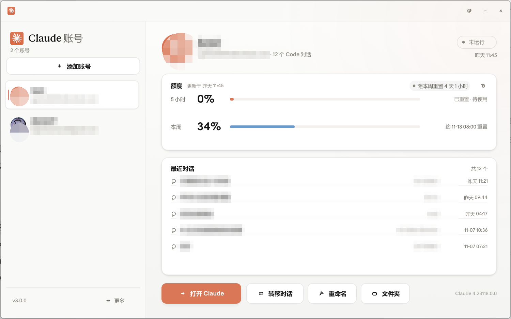
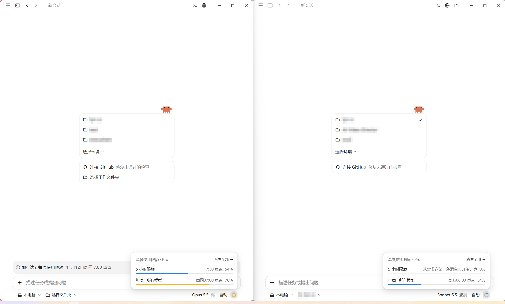

# Claude Account Switcher

English | [简体中文](README.zh-CN.md)

A portable Windows tray app for running several Claude desktop accounts side by side.
Each account keeps its own profile directory, so switching never asks you to sign in again.

It targets the **official Claude desktop app for Windows** (tested with 4.23118.x) and is
actively maintained: if a Claude update breaks the switcher, a fix follows as soon as possible.


*Screenshots use redacted account details.*

Two accounts running side by side:



## Features

- **Accounts** — lists the profiles already on this PC with e-mail, running state and Claude Code conversation count.
- **Usage** — live 5-hour / weekly usage, reset countdown, and a warning shortly before a reset.
- **Switching** — opens or focuses an account in its own window, and copies Claude Code conversations between accounts.
- **Personal** — avatar and nickname per account; light and dark themes.
- **Tray** — the titlebar × only closes the window; the app stays in the notification area. Quit lives in the tray menu.

## Run

`dist/Claude Account Switcher.exe` — one file, no installer, no .NET or PowerShell.

## Build

```powershell
cargo build --release --offline
```

Output: `target\release\claude-account-switcher.exe`.

## Data & safety

The app reads Claude's profiles and settings. It writes only the conversation copies you start, plus its own settings and avatars. It never deletes an account or a conversation and makes no network requests.

Anthropic Sans/Serif are extracted locally from the installed Claude app and are not bundled.

## Credits

Based on [Claude Code Desktop Switcher](https://github.com/PriyanshuGeTRekT/Claude-Code-Desktop-Switcher) (MIT). See [LICENSE](LICENSE).
