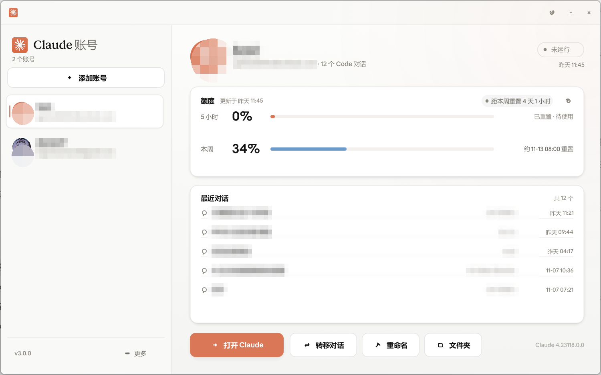
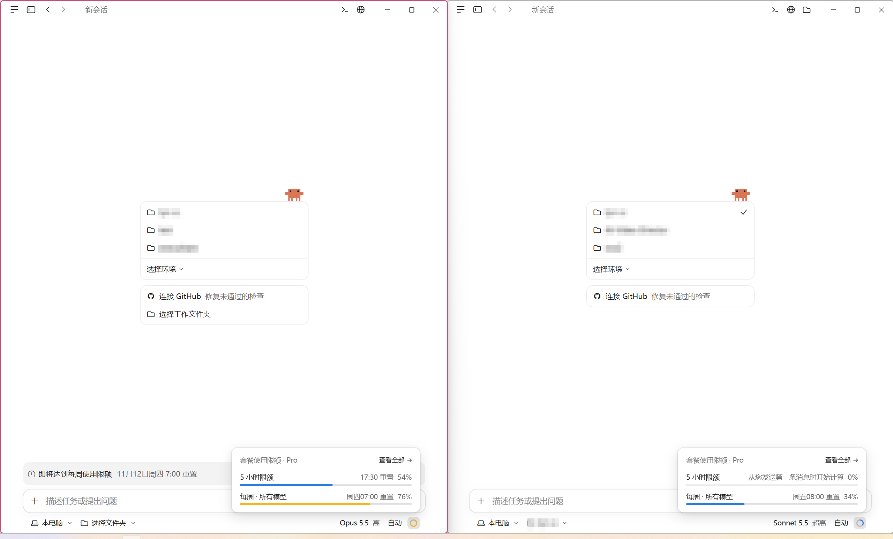

# Claude Account Switcher

[English](README.md) | 简体中文

免安装的 Windows 托盘工具，让多个 Claude 桌面版账号同时运行。
每个账号使用独立的配置目录，切换时不需要重新登录。

面向 **Windows 官方 Claude 桌面版**（已在 4.23118.x 上验证）。


*截图中账号信息已打码。*

两个账号并排运行：



## 功能

- **账号** — 自动列出现有账号的邮箱、运行状态和 Claude Code 对话数。
- **额度** — 5 小时 / 每周用量、重置倒计时，临近重置时给出提示。
- **切换** — 在独立窗口中打开或聚焦账号，并可在账号之间复制 Claude Code 对话。
- **个性化** — 每个账号可单独设置头像和昵称，支持深色 / 浅色主题。
- **托盘** — 标题栏的 × 只关闭窗口，程序留在通知区；退出在托盘右键菜单里。

## 运行

`dist/Claude Account Switcher.exe` —— 单文件，无需安装，不依赖 .NET 或 PowerShell。

## 构建

```powershell
cargo build --release --offline
```

产物：`target\release\claude-account-switcher.exe`。

## 数据与安全

只读取 Claude 的配置与设置。唯一会写入的是你主动发起的对话复制，以及切换器自己的设置和头像；不会删除账号或对话，也不发起任何网络请求。

Anthropic Sans/Serif 字体从本机已安装的 Claude 中提取，不随程序分发。

## 致谢

基于 [Claude Code Desktop Switcher](https://github.com/PriyanshuGeTRekT/Claude-Code-Desktop-Switcher)（MIT 协议）重写。见 [LICENSE](LICENSE)。
